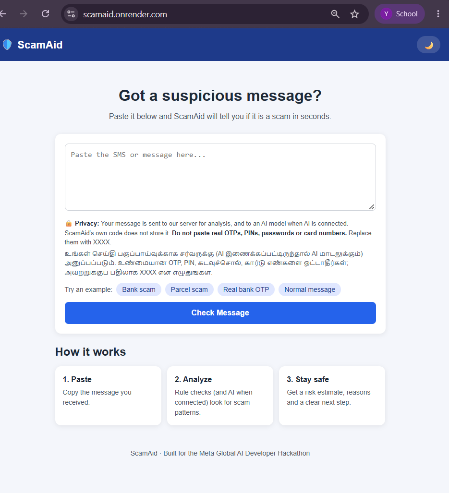
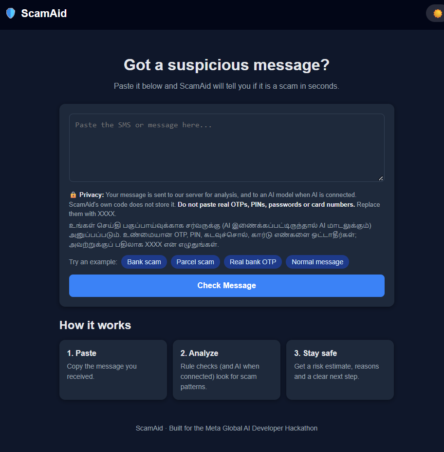
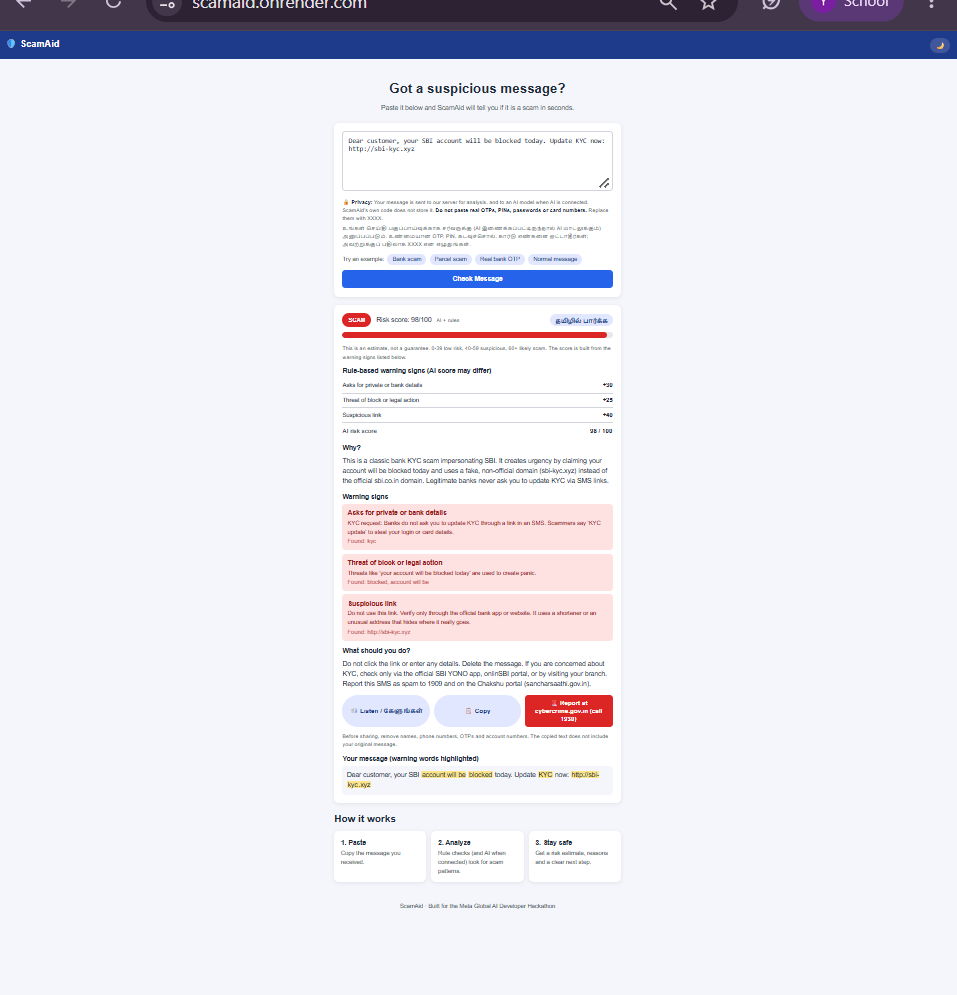
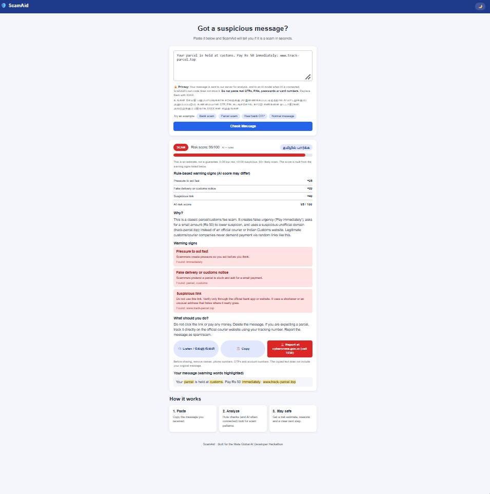
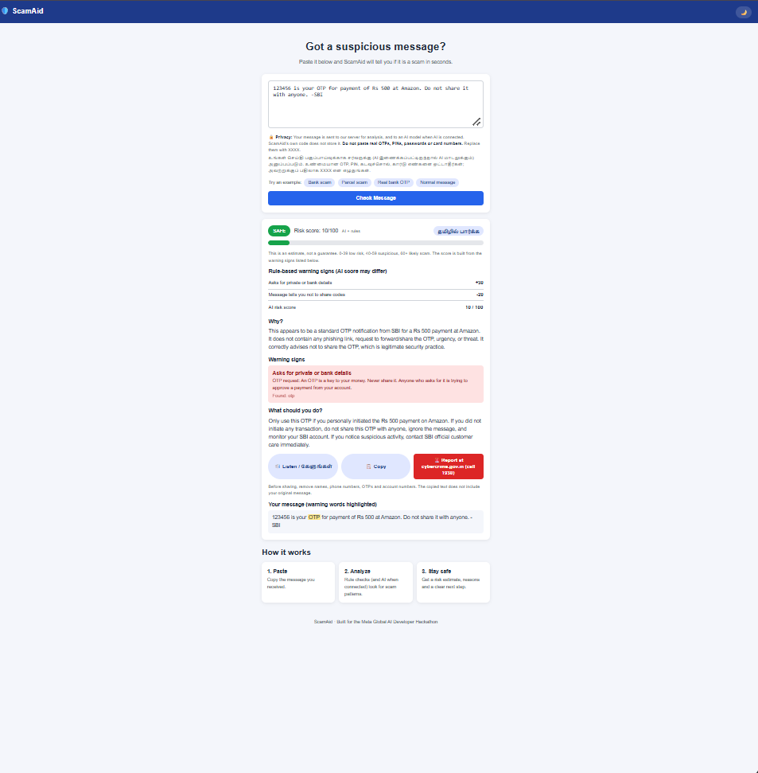
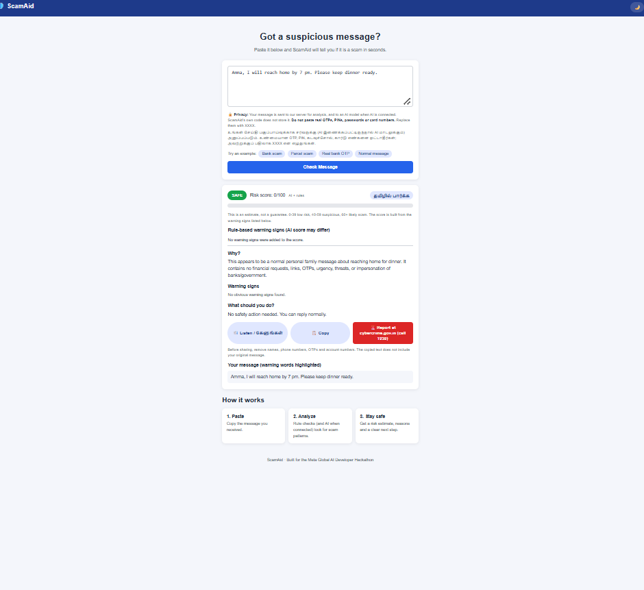

# 🛡️ ScamAid

ScamAid is a scam message checker. Paste any suspicious SMS or message, and ScamAid tells you if it looks safe, suspicious, or a scam. It shows a risk estimate, explains why, and gives a clear next step.

Built for the Meta Global AI Developer Hackathon.

🔗 **Live demo:** https://scamaid.onrender.com

## Screenshots

### Light mode


### Dark mode


### Scam examples



### Safe examples



## Features
- Risk estimate (0-100) with a breakdown of how the score was calculated
- Plain-language explanation of each warning sign (for example, why a KYC request is risky)
- Specific next-step advice (for example, "open the official YONO SBI app")
- Tamil and English results
- Highlights suspicious words in the message
- Voice: read results aloud (Listen button)
- Copy result to share with family (does not include your original message)
- One-click report link (cybercrime.gov.in, helpline 1930)
- Privacy reminder before you paste a message
- Clear error message if analysis is unavailable
- Dark and light mode, mobile friendly
- AI analysis using Meta Model API when a key is connected, with rule-based fallback

## Tech stack
- Backend: Python, FastAPI
- Frontend: HTML, CSS, JavaScript
- AI: Meta Model API (optional layer on top of rule-based checks)
- Hosting: Render

## Run locally

1. Clone the repo.
2. Create a virtual environment and install packages:

```
pip install -r requirements.txt
```

3. Create a `.env` file:

```
LLM_API_KEY=your_key
LLM_BASE_URL=https://api.meta.ai/v1
LLM_MODEL=muse-spark-1.1
```

4. Start the server:

```
uvicorn app:app --reload
```

5. Open http://127.0.0.1:8000

## Privacy and notes
- ScamAid's own code does not store your messages. They are sent to the server only to be analyzed.
- When an AI key is connected, the message is also sent to the Meta Model API. Meta may keep it according to its own data policy, so please check that policy.
- Please do not paste real OTPs, PINs, passwords or card numbers. Replace them with XXXX.
- The API key stays on the server only. It is never sent to the browser.
- If the AI call fails or no key is set, ScamAid uses rule-based checks.
- ScamAid gives a risk estimate, not a guarantee. When in doubt, contact your bank through its official app or the number on your card.