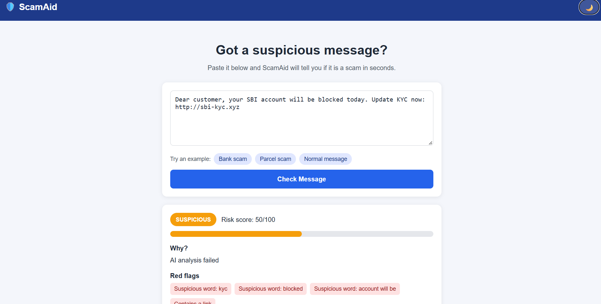
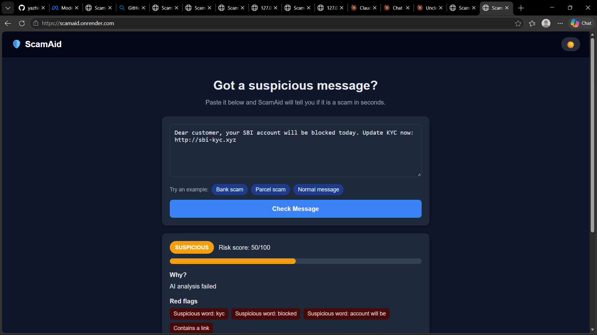

# 🛡️ ScamAid

ScamAid is a scam message detector. Paste any suspicious SMS or message, and ScamAid tells you if it is safe, suspicious, or a scam, with a risk score, red flags, and advice on what to do.

Built for the Meta Global AI Developer Hackathon.

## Features
- Risk score meter (0-100)
- Red flag detection (urgent words, suspicious links)
- AI analysis using Meta Model API
- Clear advice on what to do next

## Tech stack
- Backend: Python, FastAPI
- Frontend: HTML, CSS, JavaScript
- AI: Meta Model API

## Run locally

1. Clone the repo.
2. Create a virtual environment and install packages:

```
pip install -r requirements.txt
```

3. Create a `.env` file:

```
LLM_API_KEY=your_key
LLM_BASE_URL=https://api.meta.ai/v1
LLM_MODEL=muse-spark-1.1
```

4. Start the server:

```
uvicorn app:app --reload
```

5. Open http://127.0.0.1:8000
🔗 **Live demo:** https://scamaid.onrender.com
## Screenshots


